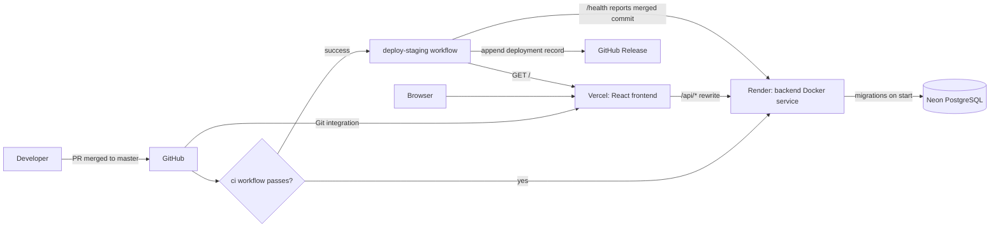

# Deployment and release strategy

Hosting as chosen in issue #5: backend on Render, frontend on Vercel, PostgreSQL on Neon.
This page is written to be copied to the project wiki.

## Deployment diagram

## Staging environment

| Component | Host | URL |
| --- | --- | --- |
| Backend (FastAPI, Docker) | Render, Ohio | https://powr-backend-staging.onrender.com |
| Frontend (React, Vite) | Vercel | https://powr-rho.vercel.app |
| Database (PostgreSQL) | Neon, AWS US East 2 (Ohio) | private connection string, set only in Render |

The free tiers sleep when idle, so the first request after a pause can take about a minute.

## How a merge reaches staging

1. A PR merges to `master` and the `ci` workflow runs.
2. Render (`autoDeployTrigger: checksPass` in [render.yaml](../render.yaml)) builds the backend image once CI passes. On
   start the container applies the migrations (`python -m app.core.database up`) and launches the API.
3. Vercel builds `frontend/` from `master`. [vercel.json](../frontend/vercel.json) proxies `/api/*` to Render, so the
   session cookie stays same-origin.
4. [deploy-staging.yml](../.github/workflows/deploy-staging.yml) waits until `/health` reports the merged commit,
   checks `status` and `database` are `ok`, checks the frontend loads, then records the result.

## Secrets and configuration

Secrets exist only in the hosts' settings. GitHub stores none.

| Where | Name | Notes |
| --- | --- | --- |
| Render | `DATABASE_URL` | Neon connection string (`postgresql://...?sslmode=require`) |
| Render | `SESSION_SECRET_KEY` | generated by the blueprint |
| Render | `CORS_ORIGINS` | `["https://powr-rho.vercel.app"]` (JSON list of the Vercel URL) |
| Render | `ENVIRONMENT=staging`, `COOKIE_SECURE=true` | the app refuses to start otherwise |
| GitHub repository variables (not secrets) | `STAGING_API_URL`, `STAGING_APP_URL` | the two URLs above, without a trailing slash |

The Render service builds the `master` branch and auto-deploys after CI checks pass.

## Deployment record

When a release is deployed, `deploy-staging` appends a section to that GitHub Release with the version/tag, commit SHA,
environment, UTC date and outcome, plus a link to the run. Releases are created by release-please and kept permanently,
so every deployed version stays identifiable. Deployments also appear under the repository's `staging` environment.

## Rollback

Render: redeploy a previous deploy from the dashboard. Vercel: promote a previous deployment. Database scripts only add
what is missing, so a schema change that must be undone needs a new compensating script.

## Release strategy

| Stage | Audience | Environment | Promotion gate |
| --- | --- | --- | --- |
| Stakeholder | Course stakeholders / product owner | staging, every merge | CI and smoke test green; demo reviewed |
| Friends and family | A few trusted users | staging, tagged release | No open critical bugs; feedback collected |
| Alpha | A small set of real kitchens | production | Stakeholder sign-off; Neon backups enabled |
| Beta | Wider invite-only group of restaurants | production | Alpha exit criteria met; no data-loss bugs |
